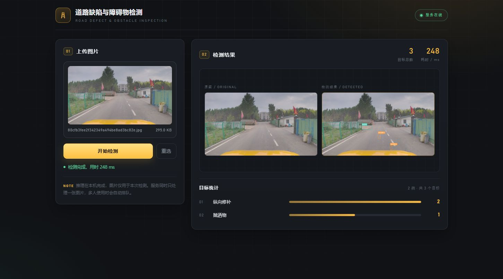

# 道路缺陷与障碍物检测系统

基于 **Ultralytics YOLO + Flask + PyQt5** 的道路病害检测系统：既提供浏览器端 Web 界面，也提供桌面客户端，支持本机、局域网和公网远程访问。




## 功能特性

- **Web 端**：点击或拖拽上传图片，展示原图与标注结果对比，按类别统计检出数量
- **桌面端**：PyQt5 客户端通过 HTTP 调用后端，可连接本机或远程服务
- **REST API**：`/predict` 支持图片上传与置信度阈值调整，返回检测框、类别、置信度和耗时
- **19 类道路病害与障碍物**：覆盖裂缝、坑槽、修补、井盖、锥形桶、抛洒物等
- **中文标签渲染**：使用 PIL + 微软雅黑绘制检测框，避免 OpenCV 中文乱码
- **GPU 加速**：RTX 4060 Laptop 上单张 3060×4080 图片推理约 0.3 秒，无 GPU 时自动回落到 CPU
- **响应式界面**：手机端自动切换为单列布局，可直接在手机上完成检测
- **支持内网穿透**：通过 cpolar 把本机服务映射到公网，配合 `PUBLIC_PREFIX` 保证图片地址正确

## 检测类别

模型输出 19 个类别：

`坑槽`、`纵向修补`、`横向修补`、`块状修补`、`抛洒物`、`人`、`横向裂纹`、`纵向裂纹`、`标线模糊`、`网状裂纹`、`锥形桶`、`方形雨水盖`、`网状修补`、`松散`、`护栏损坏`、`圆形桶`、`纵向裂缝`、`圆形雨水盖`、`圆形井盖`

## 技术栈

| 层次 | 技术 |
| --- | --- |
| 模型推理 | Ultralytics YOLO、PyTorch 2.1（CUDA 12.1）、OpenCV |
| 后端服务 | Flask 3.1、Pillow（中文标签绘制） |
| Web 前端 | 原生 HTML / CSS / JavaScript，无框架依赖 |
| 桌面客户端 | PyQt5 + Requests（QThread 异步请求） |
| 部署 | 局域网访问、cpolar 内网穿透 |

## 项目结构

```text
road_detection_deploy/
├── app.py                  # Flask 服务：页面、健康检查、推理接口、结果绘制
├── pyqt_ui.py              # PyQt5 桌面客户端
├── best.pt                 # YOLO 模型权重（约 21MB）
├── requirements.txt        # 依赖清单
├── templates/
│   └── index.html          # Web 检测界面
├── static/                 # 运行时生成：upload/ 原图，output/ 标注结果
├── .screenshots/
│   └── web-ui.png          # 界面截图
└── .gitignore
```

## 快速开始

### 1. 环境准备

- Python 3.9+（推荐 3.11）
- Windows / Linux 均可运行，Linux 下中文标签字体会自动回落到系统字体

```bash
git clone https://github.com/YEEMOTY/road-defect-detection.git
cd road-defect-detection

python -m venv .venv
# Windows
.venv\Scripts\activate
# Linux / macOS
source .venv/bin/activate

pip install -r requirements.txt
```

> 默认安装 CPU 版 PyTorch。如需 GPU 加速，请到 [pytorch.org](https://pytorch.org/get-started/locally/) 按自己的 CUDA 版本安装 `torch` 与 `torchvision`。

### 2. 准备模型

将训练好的权重放到项目根目录并命名为 `best.pt`，或通过环境变量指定其他路径：

```powershell
$env:MODEL_PATH = "D:\weights\road_best.pt"
```

### 3. 启动服务

```bash
python app.py
```

浏览器打开 <http://127.0.0.1:5000>，上传图片即可检测。

### 4. 启动桌面客户端（可选）

```bash
python pyqt_ui.py
```

客户端默认连接 `http://127.0.0.1:5000`，连远程服务时设置：

```powershell
$env:ROAD_API_URL = "https://xxxx.cpolar.io"
python pyqt_ui.py
```

## 接口说明

### `GET /health`

```json
{
  "code": 200,
  "msg": "服务正常",
  "model": "best.pt",
  "classes": ["坑槽", "纵向修补", "横向修补"]
}
```

### `POST /predict`

表单字段：

| 字段 | 必填 | 说明 |
| --- | --- | --- |
| `image` | 是 | 图片文件，支持 jpg / jpeg / png / bmp / webp，最大 16MB |
| `conf` | 否 | 置信度阈值，默认 0.25，范围 0.01～0.99 |

```bash
curl -X POST -F "image=@test.jpg" http://127.0.0.1:5000/predict
```

返回示例（`detections` 已截断）：

```json
{
  "code": 200,
  "msg": "推理成功",
  "data": {
    "original_url": "http://127.0.0.1:5000/static/upload/xxx.jpg",
    "image_url": "http://127.0.0.1:5000/static/output/xxx_result.jpg",
    "detections": [
      {"class": "坑槽", "conf": 0.86, "bbox": [120, 340, 480, 620]}
    ],
    "summary": {"total": 3, "counts": {"坑槽": 2, "锥形桶": 1}},
    "elapsed_ms": 316
  }
}
```

## 配置项

全部通过环境变量配置，无需改代码：

| 变量 | 默认值 | 说明 |
| --- | --- | --- |
| `MODEL_PATH` | 项目下的 `best.pt` | 模型权重路径 |
| `CONF_THRESHOLD` | `0.25` | 默认置信度阈值 |
| `HOST` | `0.0.0.0` | 监听地址，局域网访问需保持 `0.0.0.0` |
| `PORT` | `5000` | 服务端口 |
| `PUBLIC_PREFIX` | 空 | 公网访问前缀，如 `https://xxxx.cpolar.io` |
| `LABEL_FONT` | `C:\Windows\Fonts\msyh.ttc` | 中文标签字体路径 |
| `ROAD_API_URL` | `http://127.0.0.1:5000` | 桌面客户端连接的后端地址 |

## 远程访问

### 局域网

1. 手机 / 其他电脑与服务器连接同一个路由器
2. 在服务器执行 `ipconfig` 查看 IPv4 地址
3. 设备浏览器访问 `http://<服务器IP>:5000`
4. 若无法访问，用管理员权限放行端口：

```powershell
New-NetFirewallRule -DisplayName "RoadDetect-5000" -Direction Inbound -Protocol TCP -LocalPort 5000 -Action Allow
```

### 公网（cpolar）

```bash
cpolar authtoken <你的 token>
cpolar http 5000
```

终端会输出类似 `https://xxxx.cpolar.top` 的公网地址，任何设备浏览器均可访问。若结果图地址异常，启动服务时补充：

```powershell
$env:PUBLIC_PREFIX = "https://xxxx.cpolar.top"
python app.py
```

## 性能参考

| 环境 | 输入 | 服务端推理耗时 |
| --- | --- | --- |
| RTX 4060 Laptop + CUDA 12.1 | 3060×4080 手机原图 | 约 316 ms |
| 纯 CPU | 同上 | 约数秒，取决于 CPU 型号 |

推理是串行执行的，多人同时提交会排队；这是为避免多线程共享同一个 YOLO 实例导致结果错乱。

## 说明与限制

- 接口未做鉴权，公网开放时任何人拿到地址都能调用，建议演示完关闭隧道，或自行增加鉴权
- 上传原图与标注结果会保留在 `static/upload`、`static/output`，长期运行需定期清理
- 默认使用 Flask 开发服务器，适合演示与小规模使用；生产环境建议换用 waitress / gunicorn
- 前端不展示置信度，只展示类别与数量统计

## License

本项目仅用于学习与技术展示。模型权重与训练数据版权归原作者所有，请勿用于商业用途。
